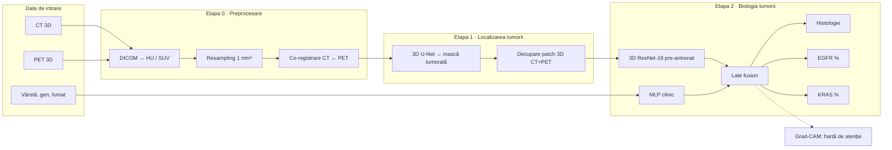

# 🫁 PulmoGnosis — Biopsie virtuală pentru cancerul pulmonar (NSCLC)

## 📄 Rezumat

PulmoGnosis este un sistem de tip **CDSS** (*Clinical Decision Support System* — software care
oferă medicului o a doua opinie, fără să ia decizia în locul lui) pentru **cancerul pulmonar
fără celule mici** (*NSCLC* — tipul care reprezintă ~85% din cancerele pulmonare).

Pornind de la o scanare **CT** (radiografie 3D a toracelui, formată din sute de secțiuni) și,
când există, o scanare **PET** (imagine care arată unde consumă corpul cel mai mult glucoză;
tumorile „se aprind"), împreună cu câteva date clinice (vârstă, gen, statut de fumător),
sistemul:

1. **găsește și conturează tumora** în volumul 3D;
2. **estimează tipul histologic** al tumorii (adenocarcinom / carcinom scuamos / carcinom cu celule mici);
3. **estimează probabilitatea mutațiilor EGFR și KRAS** (modificări genetice care decid ce tratament țintit poate primi pacientul);
4. **arată pe imagine zonele care au influențat decizia**, ca medicul să poată verifica.

Este o „biopsie virtuală": o estimare non-invazivă a biologiei tumorii, care poate ajuta la
prioritizarea testelor și a tratamentului. **Nu înlocuiește biopsia** — este un instrument de cercetare.

---

## 🗺️ Harta proiectului



| Componentă | Ce face | Antrenată pe | Rezultat |
|---|---|---|---|
| **Etapa 0** — Preprocesare | Aduce toate scanările la aceeași scară și aliniază CT cu PET | — (algoritmic, fără învățare) | Volume CT + PET aliniate, 1 mm/voxel |
| **Etapa 1** — Localizare | Găsește tumora și o decupează | LIDC-IDRI, apoi ajustat pe NSCLC-Radiogenomics + Lung-PET-CT-Dx | Mască 3D + patch 64³ în jurul tumorii |
| **Etapa 2** — Clasificare | Estimează histologia și mutațiile | Lung-PET-CT-Dx + NSCLC-Radiogenomics | Probabilități + hartă Grad-CAM |

---

## 🏗️ 1. Intrări și ieșiri

### Intrări

| Intrare | Detalii | Obligatoriu? |
|---|---|---|
| **CT toracic 3D** (DICOM) | Rezoluție anatomică înaltă: forma, marginile (*spiculații* — prelungiri ca niște ace ale tumorii) și densitatea | Da |
| **PET-CT cu FDG** (DICOM) | Activitate metabolică; tumorile agresive captează mai multă glucoză marcată radioactiv (*FDG*) | Nu — modelul funcționează și doar cu CT |
| **Date clinice** | Vârstă, gen, statut de fumător (niciodată / fost / actual) | Da (pot lipsi parțial) |

> **De ce fumatul?** Mutațiile EGFR apar mult mai des la nefumători, iar KRAS la fumători.
> Statutul de fumător este unul dintre cei mai puternici predictori clinici pentru aceste mutații.

### Ieșiri

| Ieșire | Tip | Semnificație clinică |
|---|---|---|
| **Mască tumorală 3D** | Segmentare | Unde este tumora și cât de mare este |
| **Histologie** | Probabilități care însumează 100% (*softmax*) | **Adenocarcinom** (din celulele glandulare, cel mai frecvent), **carcinom scuamos** (din celulele plate ale căilor respiratorii, legat de fumat), **carcinom cu celule mici** (agresiv, tratat complet diferit) |
| **EGFR mutant** | Probabilitate 0–100% (*sigmoid*) | Candidat pentru terapie țintită cu inhibitori de tirozin-kinază (*TKI* — pastile care blochează semnalul de creștere al tumorii) |
| **KRAS mutant** | Probabilitate 0–100% (*sigmoid*) | Candidat pentru inhibitori KRAS (ex. pentru varianta G12C) |
| **Hartă Grad-CAM** | Imagine suprapusă pe CT | Ce regiuni ale tumorii au contat cel mai mult pentru predicție |

> **Ce nu prezice (încă):** ALK, ROS1 și PD-L1. Setul public cu mutații are doar 2 cazuri ALK
> pozitive și nu conține ROS1 sau PD-L1, deci acestea rămân direcții viitoare (vezi §9).

---

## 🧬 2. Date

Toate seturile sunt publice, anonimizate și descărcabile din **TCIA** (*The Cancer Imaging Archive*).

| Set de date | Pacienți | Modalități | Etichete | Rol în proiect |
|---|---|---|---|---|
| **LIDC-IDRI** | 1010 | CT | Noduli conturați de până la 4 radiologi | **Etapa 1**: antrenarea segmentării; pre-antrenarea encoderului 3D |
| **NSCLC-Radiogenomics** | 211 | CT, PET (201), măști tumorale (144) | EGFR (43 mutanți / 172 cunoscuți), KRAS (38 / 171), histologie, vârstă, gen, fumat | **Etapa 2**: singura sursă pentru mutații; ajustarea Etapei 1 |
| **Lung-PET-CT-Dx** | 355 | CT, PET (parțial) | Histologie din biopsie (251 adeno, 61 scuamos, 38 celule mici, 5 celule mari), casete în jurul tumorii, vârstă, gen, fumat | **Etapa 2**: histologie; ajustarea Etapei 1 |
| Kaggle Chest CT-Scan | ~1000 imagini 2D | JPG/PNG | 4 clase (3 tipuri + normal) | Doar *baseline* 2D de comparație (fără ID de pacient, fără HU) |

**Total pentru histologie:** ~560 pacienți. **Total pentru mutații:** ~170 pacienți.

---

## ⚙️ 3. Pipeline-ul în detaliu

### Etapa 0 — Preprocesare

| Pas | Ce înseamnă | De ce |
|---|---|---|
| **Conversie CT → HU** | *Unități Hounsfield*: scară standard de densitate (aer ≈ −1000, apă = 0, os ≈ +1000) | Valorile brute diferă între scanere |
| **Conversie PET → SUV** | *Standardized Uptake Value*: captarea de glucoză corectată pentru doză și greutatea pacientului | Altfel un pacient mai greu ar părea că are o tumoră „mai puțin activă" |
| **Resampling** | Toate volumele aduse la voxeli de 1×1×1 mm (*voxel* = pixel 3D) | Scanerele au grosimi de secțiune între 0,6 și 5 mm |
| **Co-registrare** | Alinierea PET (≈4 mm/pixel) peste CT (≈1 mm/pixel) | Același voxel trebuie să fie același punct din corp în ambele imagini |
| **Ferestruire și normalizare** | CT tăiat la [−1000, 400] HU și scalat la [0, 1]; SUV normalizat | Rețelele învață mai stabil pe valori în interval mic |

### Etapa 1 — Localizarea tumorii (segmentare)

- **Model:** **3D U-Net** (rețea în formă de „U": prima jumătate comprimă imaginea ca să înțeleagă
  *ce* conține, a doua o reface ca să marcheze *unde* este tumora), implementat cu MONAI sau
  configurat automat cu **nnU-Net**.
- **Antrenare în doi pași:**
  1. pe **LIDC-IDRI** (1010 pacienți, noduli pulmonari conturați de radiologi);
  2. **ajustare fină** (*fine-tuning* — continuarea antrenării pe date mai apropiate de sarcina finală)
     pe cele 144 de măști din NSCLC-Radiogenomics și pe casetele din Lung-PET-CT-Dx, pentru că
     tumorile NSCLC sunt de obicei mai mari decât nodulii de screening din LIDC.
- **Ieșire:** mască 3D + un **patch** (cub de 64×64×64 voxeli) centrat pe tumoră, din CT și PET.
- **Evaluare:** **scor Dice** (cât se suprapune conturul prezis cu cel real: 0 = deloc, 1 = perfect)
  și **sensibilitate** (ce procent din tumori sunt găsite).
- **Scurtătură pentru dezvoltare:** pentru pacienții care au deja mască sau casetă, Etapa 2 poate
  folosi direct adnotarea, astfel încât cele două etape se pot dezvolta în paralel.

### Etapa 2 — Biologia tumorii (clasificare multimodală, multi-task)

```
patch CT+PET (2 canale, 64³) ──► 3D ResNet-18 (pre-antrenat) ──► vector imagine (512)
                                                                         │
vârstă, gen, fumat ────────────► MLP ───────────────────────► vector clinic (32)
                                                                         │
                                                       concatenare (544) ▼
                                                     straturi dense comune
                                              ┌─────────────┼─────────────┐
                                        Histologie        EGFR          KRAS
                                        (softmax)       (sigmoid)     (sigmoid)
```

- **Ramura de imagine:** **3D ResNet-18** (rețea de 18 straturi cu *conexiuni reziduale* —
  scurtături care permit antrenarea stabilă a rețelelor adânci).
  **Pre-antrenată** (învățată mai întâi pe alte imagini medicale, ex. greutățile **MedicalNet**),
  pentru că 170 de pacienți sunt mult prea puțini pentru antrenare de la zero
  (*transfer learning*).
- **Ramura clinică:** **MLP** (*multi-layer perceptron* — rețea simplă din câteva straturi)
  pe vârstă (normalizată), gen și fumat (codificate *one-hot* — câte o coloană 0/1 pentru fiecare categorie).
- **Fuziune târzie** (*late fusion*): fiecare tip de date e procesat separat, iar reprezentările
  sunt unite la final.
- **Învățare multi-task** (o singură rețea antrenată simultan pe mai multe sarcini înrudite):
  histologia are ~560 de pacienți etichetați, mutațiile doar ~170. Sarcina de histologie obligă
  encoderul să învețe trăsături utile ale tumorii, iar mutațiile EGFR apar aproape exclusiv în
  adenocarcinoame — sarcinile sunt legate biologic.
- **Funcție de pierdere mascată** (*masked loss*; *pierderea* = numărul pe care rețeaua încearcă
  să-l micșoreze, cât de mult greșește): dacă un pacient nu are EGFR cunoscut, acea ieșire e
  ignorată pentru el, fără să-l eliminăm din antrenare și fără să presupunem că e negativ.
- **PET lipsă:** pentru pacienții fără PET, canalul PET este pus pe zero, iar în antrenare canalul
  PET este uneori ascuns intenționat (*modality dropout*), ca rețeaua să funcționeze și doar cu CT.
- **Dezechilibrul claselor** (mult mai mulți negativi decât pozitivi): pierdere ponderată sau
  *focal loss* (pierdere care se concentrează pe exemplele greu de clasificat).
- **Augmentare** (variații artificiale ale imaginilor de antrenare: rotații mici, oglindiri, zgomot),
  ca rețeaua să memoreze mai puțin și să generalizeze mai bine.

### Explicabilitate

**Grad-CAM** (hartă care arată ce regiuni ale imaginii au influențat cel mai mult predicția)
este suprapusă peste CT, ca medicul să verifice că modelul „s-a uitat" la tumoră și nu la altceva.

---

## 📏 4. Antrenare și evaluare

| Aspect | Alegere | Explicație |
|---|---|---|
| Împărțirea datelor | **Validare încrucișată stratificată în 5 fold-uri, la nivel de pacient** | Pacienții sunt împărțiți în 5 grupuri; se antrenează pe 4 și se testează pe al 5-lea, prin rotație. *Stratificat* = fiecare grup are aceeași proporție de cazuri pozitive. Un pacient nu apare niciodată în două grupuri (altfel apare *data leakage* — modelul „vede" răspunsurile de test) |
| Metrica principală | **ROC-AUC** cu **interval de încredere bootstrap 95%** | AUC = probabilitatea ca modelul să dea un scor mai mare unui pacient pozitiv decât unuia negativ (0,5 = aruncare cu banul, 1 = perfect). *Bootstrap* = re-eșantionarea repetată a pacienților de test, ca să vedem cât de mult variază scorul din noroc |
| Metrici secundare | F1, sensibilitate, specificitate; *balanced accuracy* pentru histologie | Utile când clasele sunt dezechilibrate |
| Baseline 1 | Regresie logistică pe date clinice | Modelul complex trebuie să bată un model simplu care vede doar vârsta, genul și fumatul |
| Baseline 2 | **Radiomică** (sute de măsurători clasice de formă și textură, calculate cu PyRadiomics) + regresie logistică | Abordarea „clasică" din literatură |
| Baseline 3 | CNN 2D pe setul Kaggle | Comparație cu abordarea pe imagini 2D |
| Studiu de ablație | doar imagine / doar clinic / doar CT / CT+PET / complet / cu și fără multi-task | Măsoară contribuția fiecărei componente (*ablație* = eliminarea pe rând a câte unei părți) |
| Validare externă | Antrenare histologie pe Lung-PET-CT-Dx (China), testare pe NSCLC-Radiogenomics (SUA) | Măsoară *domain shift* (scăderea performanței când se schimbă spitalul, scanerul sau populația) |
| Comparații statistice | Testul DeLong pentru diferențe de AUC | Spune dacă o variantă e *semnificativ* mai bună, nu doar întâmplător |

> ⚠️ **Capcană cunoscută:** carcinomul cu celule mici apare doar în Lung-PET-CT-Dx. Un model ar
> putea învăța să recunoască *spitalul* (scanerul) în loc de tipul tumorii. De aceea această clasă
> se evaluează separat, iar comparația adenocarcinom vs. scuamos se face și între seturi.

---

## 🛣️ 5. Etapele de dezvoltare

Proiectul este construit incremental, astfel încât după fiecare fază există un rezultat funcțional.
Calendarul detaliat, rolurile din echipă și reperele sunt în [PLAN.md](PLAN.md).

| Etapă | Conținut | Rezultat livrabil |
|---|---|---|
| **1. Flow-ul de bază** | Aplicația demo (încărcare DICOM → vizualizare CT+PET → panou de rezultate) cu model *placeholder*; tabelul de cohortă | Aplicație funcțională cap-coadă, fără model antrenat |
| **2. Date puține** | Preprocesare pe un lot mic; regresie logistică clinică; CNN 2D pe Kaggle; primul model 3D | Primele rezultate reale pe date puține |
| **3. Date reale** | Etapa 2 (histologie + EGFR/KRAS) pe seturile complete; baseline radiomic; comparație cu literatura | Rezultate cu intervale de încredere, comparate cu SOTA |
| **4. Îmbunătățiri** | Pre-antrenare MedicalNet, PET, date clinice, multi-task, augmentare — cu ablații | Tabel comparativ al îmbunătățirilor |
| **5. Integrare** | Etapa 1 (3D U-Net) în aplicație → pipeline complet; validare externă; Grad-CAM; analiză statistică; video | Aplicație finală pentru un pacient nou, fără adnotări |
| **6. Demo** | Pitch + demo live, analiza SWOT, concluzii | Prezentare finală |

---

## 🖥️ 6. Interfața medicului (demo)

1. **Încărcare:** medicul încarcă scanările DICOM ale unui pacient și completează vârsta, genul și statutul de fumător.
2. **Vizualizare CT + PET:** tumora găsită de Etapa 1 este afișată 3D, cu structura anatomică din
   CT (gri) suprapusă cu harta termică din PET, ca medicul să confirme că a fost găsită tumora corectă.
3. **Panou de rezultate**, de exemplu:
   * Histologie: adenocarcinom 81% · scuamos 15% · celule mici 4%
   * EGFR mutant: 64% · KRAS mutant: 18%
   * Hartă Grad-CAM peste tumoră
   * Mesaj: *„Estimare de cercetare. Confirmați prin biopsie și testare moleculară."*

*(Valorile de mai sus sunt doar un exemplu de afișare, nu rezultate ale modelului.)*

---

## 📁 7. Structura repository-ului (planificată)

```
PulmoGnosis/
├── README.md                     ← acest fișier
├── PLAN.md                       ← calendar, roluri și repere
├── raport_biopsie_virtuala.tex   ← raportul tehnic
├── configs/                      ← fișiere YAML pentru experimente
├── data/                         ← (ignorat de git)
│   ├── metadata/                 ← fișiere clinice și inventare TCIA
│   ├── raw/                      ← DICOM brute, nu se modifică niciodată
│   └── processed/                ← patch-uri 3D gata de antrenare
├── src/pulmognosis/
│   ├── data/                     ← încărcarea seturilor și construirea cohortei
│   ├── preprocessing/            ← HU, SUV, resampling, co-registrare, decupare
│   ├── segmentation/             ← Etapa 1 (3D U-Net)
│   ├── classification/           ← Etapa 2 (fuziune, multi-task)
│   └── evaluation/               ← metrici, bootstrap, DeLong, Grad-CAM
├── scripts/                      ← puncte de intrare: descărcare, preprocesare, antrenare
├── tests/                        ← teste unitare (în special pentru preprocesare)
├── notebooks/                    ← explorare și verificări vizuale
└── app/                          ← interfața demo (ulterior)
```

---

## 🛠️ 8. Tehnologii

| Domeniu | Instrumente |
|---|---|
| Imagini medicale | `pydicom`, `SimpleITK` (resampling, co-registrare), `pylidc` (adnotări LIDC) |
| Deep learning | `PyTorch`, **`MONAI`** (bibliotecă de deep learning pentru imagini medicale), `nnU-Net` |
| ML clasic și statistică | `scikit-learn`, `PyRadiomics`, `pandas` |
| Urmărirea experimentelor | Weights & Biases sau MLflow |
| Date | `idc-index` / TCIA Data Retriever pentru descărcare selectivă |
| Interfață (ulterior) | React + `Cornerstone.js` / `VTK.js` pentru vizualizare DICOM în browser, sau Streamlit pentru un demo rapid |

---

## 🚀 Instalare și rulare

Necesită Python 3.12. Din rădăcina repository-ului:

```bash
py -3.12 -m venv .venv
.venv\Scripts\activate
pip install -r requirements.txt -e .
```

Pornirea aplicației demo (se deschide în browser la `http://localhost:8501`):

```bash
streamlit run app/streamlit_app.py
```

Pentru o primă încercare, alegeți **„Caz demonstrativ (fantomă sintetică)"** la pasul 1: un CT + PET
generat artificial (plămâni, coloană, inimă și o tumoră în plămânul drept), fără date reale de pacient.

Rularea testelor:

```bash
pytest
```

> În Etapa 1 a proiectului, aplicația are flow-ul complet, dar **fără model antrenat**: localizarea
> folosește punctul cu SUV maxim, iar panoul de rezultate afișează prevalențele din seturile de date,
> marcate vizibil ca „DEMO".

---

## ⚠️ 9. Limitări și direcții viitoare

- **Date puține pentru mutații** (~170 pacienți, ~40 pozitivi per mutație): rezultatele vor avea
  intervale de încredere largi și trebuie raportate ca atare.
- **ALK, ROS1, PD-L1** nu pot fi învățate din datele publice disponibile; necesită colaborare cu un
  spital sau seturi suplimentare (ex. TCGA-LUAD/LUSC).
- **Etichete diferite între seturi:** nodulii LIDC sunt noduli de screening (adesea mici, unii benigni),
  nu tumori NSCLC confirmate; de aceea Etapa 1 este ajustată pe seturile NSCLC.
- **Nu este un dispozitiv medical** și nu a fost validat clinic.

---

## 📚 Citarea datelor

- LIDC-IDRI: Armato III, S. G., et al. (2015). *Data From LIDC-IDRI*. TCIA. https://doi.org/10.7937/K9/TCIA.2015.LO9QL9SX
- NSCLC-Radiogenomics: Bakr, S., et al. (2017). *Data for NSCLC Radiogenomics*. TCIA. https://doi.org/10.7937/K9/TCIA.2017.7hs46erv
- Lung-PET-CT-Dx: Li, P., et al. (2020). *A Large-Scale CT and PET/CT Dataset for Lung Cancer Diagnosis*. TCIA. https://doi.org/10.7937/TCIA.2020.NNC2-0461
